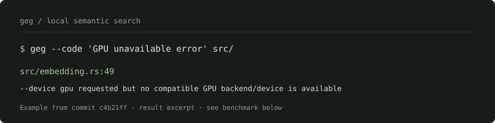

<div align="center">

# geg
### Geg Embeds Gemma

**Search by meaning. Keep your code on your machine.**  
**像 grep 一样使用，用语义寻找代码与文本。**

[](https://crates.io/crates/geg)
[](LICENSE)
[](https://www.rust-lang.org/)
[](#模型与离线运行)

[安装](#安装) · [使用示例](#使用示例) · [交互搜索](#fzf-风格交互搜索) · [仓库索引](#大型仓库显式索引) · [配置](#点文件配置) · [缓存管理](#缓存与空间管理) · [Agent 技能](#安装-agent-技能)

</div>



---

```sh
# 不必先知道函数叫什么；默认 Markdown 表格，表头只显示一次
geg --code '失败请求的重试逻辑' src/

# 机器读取时显式选择 JSONL
geg --code --jsonl -k 5 'validate passwords before login' src/

# 像 fzf 一样边输入边筛选，Tab 打开源码预览
geg --tui --code src/

# 大仓库反复检索：建完整索引，然后直接搜索
geg index src/ docs/                 # ./.geg/index.sqlite3
geg query --code 'retry failed requests'
```

**纯本地，无 API key，无推理服务器。** 使用 EmbeddingGemma 2 的 **270M 文本骨干**，不加载视觉或音频编码器。Linux / Windows 自动检测 Vulkan GPU，macOS 使用 Metal；没有可用 GPU 时使用 CPU。模型已备好后，运行时不发起网络请求。

**真实仓库试用：**在 AstrBot 的 1,850 个文件中查找登录密码验证，首次空向量缓存搜索 2.58 秒，重复查询中位数 0.11 秒，首条结果指向实际验证代码。另一次冷启动耗时 38.00 秒；机器、驱动和缓存状态都会影响速度。见[完整测试条件和结果](#实测与复现)。

> 本 README 描述 main 分支的 **0.1.1 开发版本**；已发布的 0.1.0 仍是 CPU 版本，不具备这里的新输出、GPU 和缓存管理功能。在新版正式发布前，请使用下方的 Git 源码安装命令。

## 为什么用 geg？

- **快速开始搜索**：未建索引时流式扫描文本，先筛选少量候选，再用模型做语义重排，避免第一次嵌入整个仓库。
- **明确区分快速与完整检索**：默认最多重排 32 个词法候选；`--exhaustive` 或完整索引提供更广的语义覆盖。
- **自动使用 GPU**：`--device auto` 默认开启；`--device gpu` 强制 GPU，没有兼容设备时明确报错，而不是悄悄换 CPU。
- **重复调用复用向量**：内容寻址缓存；全命中时不加载推理模型。连续查询还可使用常驻交互模式。
- **大型仓库有显式索引**：默认位于 `./.geg/index.sqlite3`；同一索引内重复文本共享向量，文档向量不再额外保留全局副本。
- **适合 agent**：默认 Markdown 表格、可选 JSONL、配套技能、0 / 1 / 2 退出码。终端进度和提示只写 stderr。

> **不是 GNU grep 的替代品。** 语义分数不是相关概率；默认快速筛选也可能漏掉没有共同关键词的相关实现。精确符号、正则、全部引用请用 `rg` / `grep`。首次完整建库并不保证在 10 秒内完成。

## 安装

### 命令行

```sh
# 当前开发版，包含本 README 描述的新功能
cargo install --git https://github.com/LIghtJUNction/geg.git --locked

# crates.io 的最新已发布版本（目前为 0.1.0，功能不同）
cargo install geg --locked
```

编译需要 **Rust 1.88+、CMake、C/C++ 编译器及 libclang**。Linux / Windows 默认编译 Vulkan 后端，还需要 Vulkan SDK 的头文件和 `glslc`；macOS 默认使用系统 Metal。

```sh
# Debian / Ubuntu
sudo apt-get install build-essential cmake clang libclang-dev libvulkan-dev glslc

# Arch Linux
sudo pacman -S --needed base-devel cmake clang vulkan-headers shaderc vulkan-icd-loader
```

macOS：安装 Xcode Command Line Tools、CMake 和 LLVM，必要时指定 `LIBCLANG_PATH`。Windows：MSVC C++ Build Tools、CMake、LLVM 和 [Vulkan SDK](https://vulkan.lunarg.com/)，设置 `VULKAN_SDK` 并把 SDK 的 `Bin` 加入 PATH。

GPU 运行还需要对应厂商的驱动和 Vulkan loader；安装 SDK 不等于驱动已可用。Linux 的软件 Vulkan 设备不代表真实 GPU 加速。默认二进制无需 CUDA toolkit；也可用 `--features cuda` 编译额外的 CUDA 后端（需要 NVIDIA CUDA 工具链，尚未完成本项目实机验证）。`--features native` 可针对编译机优化 CPU 指令，不适合直接分发到更老的 CPU。

[GitHub Releases](https://github.com/LIghtJUNction/geg/releases) 提供历史版本的单文件压缩包及 SHA-256 校验文件。**0.1.0 制品为 CPU 版**；不要把它当作新版 GPU 构建。模型权重单独准备；二进制仍依赖目标平台的标准运行库及所用 GPU 驱动。

### 本地模型

推荐 [unsloth/embeddinggemma-2-GGUF](https://huggingface.co/unsloth/embeddinggemma-2-GGUF) 的 **`embeddinggemma-2-UD-Q4_K_XL.gguf`**，约 **167.5 MiB**。只要文本权重，**不要下载 `mmproj`**。

```sh
mkdir -p ~/.cache/geg/models
curl -L --fail --retry 3 --progress-bar \
  'https://huggingface.co/unsloth/embeddinggemma-2-GGUF/resolve/main/embeddinggemma-2-UD-Q4_K_XL.gguf' \
  -o ~/.cache/geg/models/embeddinggemma-2-UD-Q4_K_XL.gguf

export GEG_MODEL="$HOME/.cache/geg/models/embeddinggemma-2-UD-Q4_K_XL.gguf"
```

这是用户显式执行的一次性下载，`curl` 显示下载进度。**geg 不自动下载模型**；模型缺失时明确报错。可在联网机器下载后离线拷贝，以 `--model` / `GEG_MODEL` 指定任何位置的模型。Linux 默认模型位于用户缓存目录 `models/` 下；macOS / Windows 推荐显式指定路径。

```powershell
$env:GEG_MODEL = 'C:\Models\embeddinggemma-2-UD-Q4_K_XL.gguf'
geg --code 'validate a password' .\src\
```

## 使用示例

### 直接搜索 / 管道

```sh
geg --code '失败请求的重试逻辑' src/
geg --code -k 5 'resource cleanup on failure' src/
geg '旅行计划' notes.txt
cat notes.txt | geg '旅行计划'
geg -r --code 'retry a request'           # 递归搜索当前目录
geg -e 'validate a login' -e 'check a password' src/
geg -f queries.txt src/                  # 每行一个语义查询，OR 匹配
```

默认只输出一张 Markdown 表格，列为 **`path`、`line`、`score`、`text`**，`line` 从 1 开始。换行用 `<br>` 表示，管道符及 Markdown / HTML 特殊字符会转义；纯括号、空白等没有语义内容的块不参与检索。

```sh
# JSONL：每条结果一个对象，不混入表头或状态日志
geg --code --jsonl 'password verification' src/

# grep 风格的逐行输出，适合已有文本处理脚本
geg --format grep -nH --score 'password verification' src/
```

JSONL 的结果结构为：

```json
{"path":"src/auth.rs","line":24,"score":0.83,"text":"...source excerpt...\n"}
```

以上对象是结构示例，不是对任意仓库的实测结果。旧的 `--json` 已改为 **`--jsonl`**，请同步更新脚本。

### 速度与覆盖率

```sh
# 默认：最多重排 32 个词法候选；语义检索可能漏掉纯同义表达
geg --code '重试逻辑' .

# 增加候选数，花更多推理时间换取更大的候选范围
geg --candidates 128 --code 'retry failed requests' .

# 不做候选筛选：为每个文本块计算/读取向量，第一次可能明显更慢
geg --exhaustive --code 'retry failed requests' .

# 强制 GPU：不可用时直接报错
geg --device gpu --code 'retry failed requests' .

# 显式使用 CPU
geg --device cpu --code 'retry failed requests' src/
```

快速模式仍遍历可见源码并流式分块；它**不是**无需读取文件的持久化索引。中文查询使用中文词组/双字组合筛选，英文使用词项；不是一个独立的多语言语义索引。超过候选上限时会在 stderr 明确说明检索不完整。`-c/-l/-L/-v/-m` 需要完整计数或过滤，会自动走完整扫描，不能套用快速模式的时间。

```sh
geg --threshold 0.75 --code 'authentication' src/
geg --threshold -1 -k 5 'authentication' src/  # 不按阈值过滤，观察候选
```

默认 8 行、最多 1024 UTF-8 字节为一个块；`--chunk-lines 1` 更接近逐行语义过滤。余弦相似度不是概率，阈值需要在自己的语料上调整。

### 进度和目录规则

终端显示当前阶段和文件/块/向量/缓存计数；非终端会在实际模型加载和推理时输出简短状态。状态都写 **stderr**，不污染 Markdown 或 JSONL。GPU 可用时显示 `using GPU inference`。首次 GPU 驱动着色器编译可能额外耗时。

```sh
geg --no-progress --code 'retry' src/     # 只关闭进度，不关闭结果
geg --hidden --code 'retry' .             # 搜索隐藏项
geg --no-ignore --code 'retry' .          # 关闭 ignore 文件过滤
```

默认遵守 `.gitignore` / `.ignore`（即使目录没有 `.git/`），跳过隐藏项。**`.git/` 和 `.geg/` 始终从递归遍历中排除**，包括使用 `--hidden --no-ignore` 时。显式指定普通文件按用户指定处理。扫描到 100 个文件时会在 stderr 推荐建索引；`--no-index-hint` 关闭建议。

## 大型仓库：显式索引

```sh
cd /path/to/project
geg index src/ docs/                     # 默认 ./.geg/index.sqlite3
geg query --code 'retry failed requests' # 默认读取 ./.geg/index.sqlite3

# 自定义位置
geg index src/ --output /private/repo.sqlite3
geg query --code --jsonl 'retry' --index /private/repo.sqlite3

# 代码变动后，重新执行同一个建索引命令
geg index src/ docs/
```

- **完整快照**：索引不做词法候选筛选；建库首次需处理所有有效块，不承诺 10 秒内完成。查询扫描已存向量，不再遍历源码。
- **增量推理**：重建仍扫描输入，但未变内容复用向量；成功后清除已删除/修改块的旧向量。不自动监听文件变化。
- **单份文档向量**：向量只保留在索引中，同内容共享一份；成功提交后移除对应全局向量副本。查询向量仍留全局缓存。普通搜索会直接借用默认/配置索引中的向量，不复制回来。
- **失败保护**：事务失败保留上次完整索引；全局向量转移发生在索引提交之后。极端情况下若提交后的转移失败，可能暂有冗余副本，再运行建索引即可重试去重。
- **兼容性**：模型、维度及 `-i` 必须一致；`--code` 只影响查询，不要求重建。0.1.0 的旧索引需要重建以使用新版格式和单份向量存储。
- **隐私**：索引保存原文片段和绝对路径。新建数据库 Unix 权限为 `0600`；已有权限不覆盖。请把 `.geg/` 加入 `.gitignore`，不要提交或公开它。
- **查询成本**：是流式精确余弦扫描，复杂度 O(块数 × 维度)，不是 ANN。源文件修改后，旧索引可能返回旧片段，请重新建库。

## 点文件配置

项目目录放 **`.gegrc.toml`**；也支持 **`~/.gegrc.toml`** 作为全局默认。从当前工作目录向上寻找最近的项目配置，遇到仓库根或用户家目录即停止；**不按每个搜索路径分别加载配置**。

```toml
# .gegrc.toml
code = true
device = "auto"          # auto | gpu | cpu
format = "md"            # md | grep；机器逐条输出可设 jsonl = true
top = 10
candidates = 32
exhaustive = false
threshold = 0.15
chunk_lines = 8
dimensions = 256
index = ".geg/index.sqlite3"
cache_warning_gb = 10    # GiB；0 关闭占用提示
no_index_hint = false
no_progress = false
no_ignore = false       # 默认遵守 ignore 规则
hidden = false
# threads = 8
# model = "/private/models/embeddinggemma-2-UD-Q4_K_XL.gguf"
# cache = "/private/geg/vectors.sqlite3"
# no_cache = false
# ignore_case = false
```

优先级：**命令行 / `GEG_MODEL`、`GEG_CACHE` > 项目配置 > 全局配置 > 内置默认值**。配置内相对路径相对于该配置文件所在目录，命令行相对路径相对于工作目录。未知键、错误类型和超范围的值明确报错；不执行配置中的脚本。

```sh
geg --config /path/.gegrc.toml 'query' src/
geg --no-config --code 'query' src/
geg --top 3 --code 'query' src/            # 覆盖配置中的 top
```

## 缓存与空间管理

全局默认目录：
- Linux：`~/.cache/geg/`（遵循 `XDG_CACHE_HOME`）。
- macOS：`~/Library/Caches/geg/`。
- Windows：用户 Local AppData 下的 geg 缓存目录。

默认向量数据库为 **`vectors.sqlite3`**；模型默认位于 `models/`。`geg cache info` 显示当前机器的实际路径和占用；`--cache` / `GEG_CACHE` 可覆盖向量数据库位置。

```sh
geg cache info                       # 不需要模型，不会触发推理
geg cache info --jsonl                # 机器可读的一条 JSON 记录
geg cache clean                      # 直接清理全局向量并压缩数据库
geg cache clean --jsonl
geg --cache /private/cache.db cache info
```

- 清理**保留模型和项目索引**；也不会递归删除整个目录。误把 `--cache` 指向项目索引或其他数据库时拒绝清理。
- 默认全局占用超过 **10 GiB** 时，每次执行搜索/索引命令在 stderr 提示检查和清理；不是自动删除，也不是硬配额。总量包含默认缓存目录中的模型/文件，以及位于目录外的自定义向量数据库。
- `--cache-warning-gb NUM` / 配置 `cache_warning_gb` 调整阈值；0 关闭提示。
- `--no-cache` 关闭自动向量缓存读写，不关闭显式索引。
- 索引提交后，全局数据库已移除对应向量，但 SQLite 的空闲页可能还保留文件容量；`geg cache clean` 会压缩并回收。

缓存键包含模型内容哈希、推理格式、维度以及完整任务指令/文本。默认 **256 维**，可选 128 / 256 / 512 / 768，归一化后每条 256 维向量为 1 KiB，另计 SQLite 开销。同内容文件共享向量；每个新进程仍哈希模型，防止替换权重后误用缓存。

## fzf 风格交互搜索

```sh
geg --tui src/                         # 边输入边模糊筛选文件
geg --tui --code 'retry failed requests' src/
geg --tui --jsonl src/                 # Enter 后只输出选中项的 JSONL
```

独立的原生终端界面，**不要求安装 fzf**。列表从底部向上排列，最佳结果和输入栏相邻：

```text
    src/config.rs
    src/cache.rs
  > src/search.rs:128        0.782
  10 matches / 1850 files · semantic results
  ↑↓ / Ctrl-P/N move · Tab preview · Enter select · Esc quit
  > retry failed requests_
```

以上是布局示意，不是实测结果。Tab 切换源码预览；支持 ↑/↓、Ctrl-P/N、PageUp/Down、Home/End、UTF-8 编辑、Ctrl-U/K/W 和粘贴。Enter 先恢复终端，再将选中项输出至 stdout；Esc / Ctrl-C 取消，退出码 1。界面本身写 stderr，stdout 可接管道。

文件列表异步模糊匹配，输入无需等待模型；停止输入 **200 ms** 后后台进行语义重排，保留已加载模型。新输入覆盖待处理查询，过期结果不会回写；已经进入原生推理的一批不能中途强制抢占。浏览文件不需要模型，语义搜索仍需 GGUF。未经过模型的文件项分数为 `0`，不是语义评分。列表最多 100,000 项；更大目录请缩小范围。

### 借鉴 dust 和 fzf

- **dust**：并行遍历（最多 4 个扫描线程），线程各自维护候选堆，结束时统一合并，避免每个文本块争抢全局锁。不额外读取每个文件的 metadata，也不保留整棵文本树。
- **有界 top-K**：只保留最佳 K 项，更新复杂度 `O(log K)`，不再每个块都排序整个候选数组。并列分数用路径和行号稳定排序，结果不受线程调度影响。
- **fzf**：借鉴字符边界、camelCase、连续字符加分和 gap 惩罚，通过 Rust 的 [nucleo](https://github.com/helix-editor/nucleo) 做路径模糊评分及异步匹配。交互层采用防抖、最新查询覆盖旧任务、后台快照与受控重绘，不是每敲一个键阻塞运行一次模型。

参考源码：[dust](https://github.com/bootandy/dust/tree/b6c6d8dc6e6c6cf19a69265493bb4737f2dcab75)、[fzf](https://github.com/junegunn/fzf/tree/26ff936df038b6a62ec42cf18db27b2ea2bb8ec3)。未复制其源码，不声称兼容 fzf 的全部评分或查询语法。模糊匹配仅筛选候选，不能替代语义模型或保证召回完整。

## 常驻交互模式

```sh
printf 'authentication\nretry logic\n' | geg --interactive --code src/
```

前台 stdin 协议，每行查询返回一个立即刷新的 JSON 响应，包含 `query`、`hits`、`counts`、`stats`；默认也使用候选筛选，`--exhaustive` 可关闭。`stats.embedded`、`cache_hits`、`candidate_chunks`、`skipped_files` 可用于验证实际工作量。单条查询失败返回 `error`，之后继续。模型和上下文保留，不开端口；每次仍扫描源文件，不与 `geg query` 的索引协议合并。

## grep 兼容边界

支持常用写法，但**不是完全兼容 GNU grep**：
- `-e/-f`：语义查询，不是正则；多个查询 OR 合并。
- `-i`：嵌入前将查询和文档转为小写。
- `-r/-R`：递归；普通搜索 `-R` 跟随符号链接，建索引不跟随。
- `-n/-H/-h`、`--score`：控制 `--format grep` 输出；默认 Markdown 有固定列。
- `-c`：完整扫描中统计选中行数，不受 top-k 截断影响。
- `-l/-L`：列出有/无选中行的文件；`-v` 选择低于阈值的块。
- `-m NUM`：每文件最多选中 NUM 行，多行块按行截短。
- `-q/--quiet/--silent`：隐藏正常结果；不保证提前结束推理。
- `-s/--no-messages`：隐藏错误提示；阈值使用 `--threshold`，不占 `-s`。
- `--label`、`--line-buffered`、`--help`、`-V/--version`。

不支持 `-E/-F/-G/-P`、`-w/-x/-o`、`-A/-B/-C`、NUL 模式、字节偏移、glob 参数或 GNU grep 全部设备策略；明确报错，不静默忽略。不预先声明完整计数/引用查询时，默认只返回快速候选中 top 10 块。

目录中的二进制文件跳过；快速遍历遇到无效 UTF-8、超 64 KiB 单行或读取错误时跳过该文件的剩余部分并汇总提示。显式文件/stdin 和完整扫描/建库遇到这些错误会明确失败；不要把跳过不支持的输入称为全部覆盖。超出 512-token 单序列窗口不静默截断。搜索字面量 `index/query/skill/cache` 时用 `--` 避免当作子命令。

退出码：搜索/索引查询 `0` 有结果、`1` 无结果、`2` 错误；建索引/缓存管理/导出技能成功为 `0`。`-L` 根据列出的无匹配文件决定状态；交互单条错误在 JSON 内报告。

## 安装 Agent 技能

命令内嵌完整的 [`skills/geg/SKILL.md`](skills/geg/SKILL.md)。**全局安装**（Pi 也识别这个目录）：

```sh
mkdir -p ~/.agents/skills/geg && geg skill > ~/.agents/skills/geg/SKILL.md
```

先完成上方的 geg 命令行安装；这条命令导出当前已安装版本的技能，不下载模型。重新打开或刷新 agent 后生效。

其他备选位置，不用全部安装：

```sh
# Pi 专用
mkdir -p ~/.pi/agent/skills/geg
geg skill > ~/.pi/agent/skills/geg/SKILL.md

# Claude Code
mkdir -p ~/.claude/skills/geg
geg skill > ~/.claude/skills/geg/SKILL.md

# Cursor
mkdir -p ~/.cursor/skills/geg
geg skill > ~/.cursor/skills/geg/SKILL.md
```

```powershell
New-Item -ItemType Directory -Force "$HOME\.agents\skills\geg" | Out-Null
geg skill | Set-Content -Encoding utf8 "$HOME\.agents\skills\geg\SKILL.md"
```

重新打开 agent 或刷新技能；Pi 使用 `/reload`。更新 geg 后重新导出，避免技能指导与已安装版本不一致。导出不需要模型，也不访问网络。

可直接告诉 agent：
> 使用 geg 在当前仓库里查找“失败请求的重试逻辑”。先快速搜索并核对源码；候选不足时扩大范围或建立完整索引。需要机器解析时用 `--jsonl`。

## 模型与离线运行

针对 [`google/embeddinggemma-2`](https://huggingface.co/google/embeddinggemma-2)，不是上一代 `embeddinggemma-300m`。官方 740M 多模态模型中的文本骨干为 270M；geg 只加载这部分 GGUF，使用 mean pooling 和官方非对称检索前缀：

```text
查询：task: search result | query: {query}
代码：task: code retrieval | query: {query}
文档：title: none | text: {content}
```

Rust 包装层使用 `llama-cpp-4 0.9`，原生引擎和 SQLite 链入可执行文件。GPU 推理采用有界多序列 batch（最多 8 序列/1024 tokens，每序列最多 512 tokens），互不混合注意力。mmap 不代表零 RAM；模型页、词表和计算图仍有占用，GPU 显存另计。模型和原生依赖遵循各自许可证；不能把 Linux 二进制直接搬到 macOS / Windows。

## 实测与复现

### 用 geg 搜索 geg 自己

2026-11-01 在公开提交 [`c4b21ff`](https://github.com/LIghtJUNction/geg/tree/c4b21ffd667b5976d80cfad8739246e41dcecf67) 的 `src/` 快照上测试；使用已安装的 0.1.1 开发版二进制、RTX 4060 Laptop GPU、Q4 模型、默认 32 个候选。每次搜索扫描 12 个文件、435 个有效块，无跳过文件。

| 查询 | 首次空向量缓存 | 重复 3 次中位数 | 首条结果与人工核对 |
| --- | ---: | ---: | --- |
| `GPU unavailable error` | 3.36 秒 | 0.10 秒 | [`src/embedding.rs:49`](https://github.com/LIghtJUNction/geg/blob/c4b21ffd667b5976d80cfad8739246e41dcecf67/src/embedding.rs#L49)：直接命中 GPU 不可用的检查及错误消息，准确。 |
| `select lexical candidates before semantic reranking` | 4.19 秒 | 0.09 秒 | [`src/candidates.rs:33`](https://github.com/LIghtJUNction/geg/blob/c4b21ffd667b5976d80cfad8739246e41dcecf67/src/candidates.rs#L33)：命中候选的词法分数排序，但没有展示完整筛选流程，只算部分相关。 |

这是两个查询的人工检查，不是总体准确率。每次首次运行使用独立空向量数据库，均计算 33 个向量；重复运行全部命中缓存。计时包含进程启动和扫描，但没有清空系统文件页缓存或 GPU 驱动缓存。速度因机器和缓存状态而异。

复现（先按上文安装开发版并准备模型；`--device cpu` 可在无 GPU 时替换 `gpu`）：

```sh
git clone https://github.com/LIghtJUNction/geg.git
cd geg
git checkout c4b21ffd667b5976d80cfad8739246e41dcecf67
export GEG_MODEL="$HOME/.cache/geg/models/embeddinggemma-2-UD-Q4_K_XL.gguf"
python3 scripts/benchmark.py --binary "$(command -v geg)" --model "$GEG_MODEL" \
  --device gpu --repository src --query 'GPU unavailable error'
python3 scripts/benchmark.py --binary "$(command -v geg)" --model "$GEG_MODEL" \
  --device gpu --repository src --query 'select lexical candidates before semantic reranking'
```

脚本输出 `cold_search.seconds`、`warm_search_median_s` 和 `first` 命中；打开对应源码人工核对。为固定二进制版本，可先运行 `cargo install --git https://github.com/LIghtJUNction/geg.git --rev c4b21ffd667b5976d80cfad8739246e41dcecf67 --locked`。不要在有未提交工作的已有检出中直接执行示例的 checkout。

### AstrBot 实测（2026-11-01）

使用 AstrBot 提交 [`59e44a76`](https://github.com/AstrBotDevs/AstrBot/tree/59e44a76d88279d7b50f18b9a862c81bae71737a)，Linux x86_64、i9-12900HX、RTX 4060 Laptop GPU、Q4 模型及 256 维向量。未建完整索引，默认快速模式扫描 1,850 个文件中的 59,441 个有效块，对 32 个候选做语义重排；统计显示有 **1 个文件被跳过**，因此不代表覆盖整个仓库。

| 查询 | 空向量缓存首次搜索 | 同一查询重复 3 次中位数 | 首条结果及人工核对 |
| --- | ---: | ---: | --- |
| `失败请求的重试逻辑` | 38.00 秒 | 0.12 秒 | [gsv_selfhosted_source.py:81](https://github.com/AstrBotDevs/AstrBot/blob/59e44a76d88279d7b50f18b9a862c81bae71737a/astrbot/core/provider/sources/gsv_selfhosted_source.py#L81)：失败后等待并重试，最终失败时抛出异常。 |
| `authenticate user password` | 2.58 秒 | 0.11 秒 | [auth_service.py:305](https://github.com/AstrBotDevs/AstrBot/blob/59e44a76d88279d7b50f18b9a862c81bae71737a/astrbot/dashboard/services/auth_service.py#L305)：检查请求类型并调用密码验证函数。 |

每个查询使用各自的空临时向量数据库，首次均嵌入 33 次，重复运行均命中 33 条缓存、不加载模型；计时包含进程启动、扫描和输出。操作系统文件页缓存和 GPU 驱动缓存没有清空，两个查询也不是相同负载的对照实验。38 秒的具体原因未确认；这些是单机样本，不是速度保证或召回率评估。搜索分数不是概率，结果仍需结合源码核对。

### 历史测试

测试仓库：**AstrBot**，扫描 1,850 个文件 / 59,441 个有效文本块。Linux x86_64、i9-12900HX、RTX 4060 Laptop GPU，推荐 Q4 GGUF、256 维、默认 32 候选，查询“失败请求的重试逻辑”：

- 并行遍历 + 有界候选堆版本，空的独立向量数据库，GPU 着色器缓存已建立：**3.13 秒**，33 次嵌入、0 个向量缓存命中，峰值主机 RSS 约 **385 MiB**。首条命中为 `gsv_selfhosted_source.py:81` 中实际的失败请求重试代码。
- 同一查询再运行 3 次，中位数 **0.14 秒**、峰值主机 RSS 约 **20 MiB**；33 个向量缓存命中、0 次推理。仍扫描源码，未预先建立完整索引。
- 最首次 Vulkan 着色器编译的尝试：**32.42 秒**，峰值主机 RSS 约 **585 MiB**，显存另计。不能将其隐去后宣称所有冷启动都低于 10 秒。
- GPU 日志确认 **25/25 层卸载至 GPU**；不是只检测到了 GPU、仍在 CPU 上计算。

这是目标机器的一次实测，不是速度上限保证，也不是完整索引耗时。空向量缓存不等于清空系统文件页缓存或 GPU 驱动缓存。macOS Metal / Windows Vulkan 构建路径保留，但尚未完成新版在这些平台的实机 GGUF 推理测试。

```sh
# 小型合成语料基准，独立临时向量缓存
python3 scripts/benchmark.py --binary target/release/geg --model "$GEG_MODEL"

# 真实仓库基准：不修改源码，独立临时缓存
python3 scripts/benchmark.py --binary target/release/geg --model "$GEG_MODEL" \
  --device gpu --repository /path/to/AstrBot --query '失败请求的重试逻辑'
# 对真实仓库还要测完整索引时，另加 --with-index（可能很慢）
```

## 本地开发与验证

```sh
cargo fmt --check
cargo clippy --all-targets --locked -- -D warnings
cargo test --release --locked
cargo doc --no-deps --locked
python3 scripts/test_tui.py --binary target/release/geg  # Unix PTY，无需桌面或模型
# 可选：真实 GPU、同一上下文两轮查询、选中退出和终端恢复回归
python3 scripts/test_tui.py --binary target/release/geg \
  --model "$GEG_MODEL" --repository /path/to/AstrBot
GEG_TEST_MODEL=/path/model.gguf cargo test --release --locked \
  --test cli real_model_semantic_smoke -- --ignored
cargo install --path . --locked
```

默认测试使用明确标注的预置向量，不下载模型；覆盖管道、退出码、表格转义、配置优先级、ignore、增量索引、回滚、向量单份存储、缓存管理及提示。PTY 回归另测 Esc/Enter、中文编辑、模糊筛选、Tab 预览、stdout 纯净和退出后终端状态恢复。可选的真实 GPU PTY 回归另外验证两轮语义查询和后台线程安全退出。真实 GGUF 推理另行实测，不把预置向量测试当作模型质量评测。可选 CUDA/native 特性需对应工具链；不要在缺少 CUDA 环境时盲目使用 `--all-features`。

## English

**geg** is a local semantic grep powered by the **270M text backbone of EmbeddingGemma 2**. No embedding API, Python runtime, or inference server. GPU detection is automatic (Vulkan on Linux/Windows, Metal on macOS); `--device gpu` requires a working GPU.

```sh
cargo install --git https://github.com/LIghtJUNction/geg.git --locked
export GEG_MODEL=/path/embeddinggemma-2-UD-Q4_K_XL.gguf
geg --code 'retry failed requests' src/             # Markdown table
geg --code --jsonl 'retry failed requests' src/     # one JSON object per hit
geg index src/                                    # ./.geg/index.sqlite3
geg query --code 'retry failed requests'
geg cache info
geg cache clean
```

`geg --tui src/` opens a built-in fzf-style picker: bottom prompt, live fuzzy filtering, debounced background semantic reranking, Tab preview, Enter to select. No external fzf required. Headless agents should use `--interactive` instead.

Default unindexed retrieval lexically shortlists 32 chunks and semantically reranks them. It can miss relevant paraphrases; use `--exhaustive` or a full index for broader semantic recall. Ignore files are respected by default, and recursive traversal always excludes `.git` and `.geg`. Configuration: project/global `.gegrc.toml`; CLI/environment override config. Models are provisioned separately. Indexes contain source excerpts; keep them private. `cache clean` preserves models and project indexes.

Install the global agent skill: create `~/.agents/skills/geg`, run `geg skill > ~/.agents/skills/geg/SKILL.md`, then reload the agent. Precise symbols and regex still belong to `rg`/`grep`; geg is not a fully compatible replacement.

## License

[MIT](LICENSE). Model weights and native dependencies retain their own licenses. nucleo/nucleo-matcher are unmodified MPL-2.0 dependencies; see [third-party notices](THIRD_PARTY_NOTICES.md) for license and source links.
